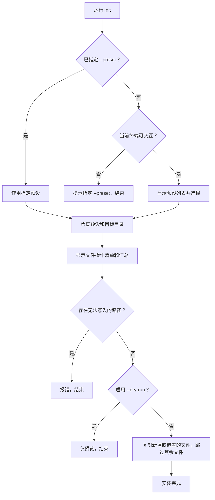

# agent-docs-cli

在已有项目中安装 `AGENTS.md` 和 `docs/` 开发规范。运行命令后选择一套预设，CLI 将该预设的文件复制到当前项目。

### 配置持续更新中…|

## 使用方式

需要 Node.js 20 或更高版本。进入已有项目后执行：

```powershell
cd ./my-project
npx agent-docs-cli@latest init
```

CLI 会列出可用预设，可输入编号或名称；直接回车选择第一项。选定后会显示每个文件的处理方式，并立即执行安装。非交互环境须使用 `--preset`。若希望固定模板版本，把 `@latest` 换成具体版本号

### `init` 执行流程



## 命令与参数

| 命令                                    | 功能                                                      |
| --------------------------------------- | --------------------------------------------------------- |
| `npx agent-docs-cli@latest init`      | 选择预设并安装到当前目录；省略子命令时也会执行 `init`。 |
| `npx agent-docs-cli@latest list`      | 列出可用预设；目前只有 `default`。                      |
| `npx agent-docs-cli@latest --help`    | 显示命令帮助。                                            |
| `npx agent-docs-cli@latest --version` | 显示 CLI 版本。                                           |

`init` 可使用以下参数：

| 参数                | 功能                                               |
| ------------------- | -------------------------------------------------- |
| `--preset <名称>` | 直接指定预设，跳过交互选择；非交互环境必填。       |
| `--target <目录>` | 指定已存在的目标目录；默认是执行命令时的当前目录。 |
| `--dry-run`       | 只预览文件处理清单，不写入文件。                   |
| `--force`         | 覆盖目标项目中与预设同名的普通文件。               |

例如，先预览覆盖范围，再执行安装：

```powershell
npx agent-docs-cli@latest init --preset default --dry-run --force
npx agent-docs-cli@latest init --preset default --force
```

## 许可证

本项目的代码和预设模板均采用 [MIT License](LICENSE)。将模板复制到其他项目并再次分发时，请保留相应的版权和许可声明。
